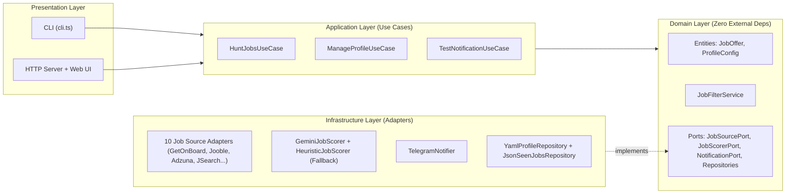

# AI Job Hunter 🌍🤖

Sistema automatizado en **TypeScript / Node.js** diseñado bajo **Clean Architecture (Hexagonal / Ports & Adapters)** para buscar ofertas de empleo en múltiples portales y países, filtrarlas y puntuarlas del **1 al 10 con Google Gemini**, y enviarte cada mañana las mejores vacantes por **Telegram**. Listo para ejecutarse **100% gratis en GitHub Actions** y configurarse desde un **Panel Web local** o [`config/profile.yaml`](config/profile.yaml).

---

## 🏛️ Arquitectura y Patrones de Diseño

El proyecto separa estrictamente las reglas de negocio de los detalles externos (APIs, SDK de Gemini, archivos YAML/JSON, Telegram y CLI/HTTP):



### Patrones aplicados
- **Clean Architecture & Hexagonal (Ports & Adapters):** El dominio (`src/domain`) no depende de ninguna librería externa ni framework; todos los adaptadores (`src/infrastructure`) implementan interfaces/puertos del dominio.
- **Inversión y Inyección de Dependencias (DIP / Composition Root):** Centralizado en [`src/infrastructure/di/container.ts`](src/infrastructure/di/container.ts), facilitando pruebas unitarias con puertos simulados sin red real.
- **Strategy + Fallback Pattern:** [`GeminiJobScorer`](src/infrastructure/ai/GeminiJobScorer.ts) evalúa con Google Gemini (rotando modelos automáticamente ante `404`/`503`) y delega a [`HeuristicJobScorer`](src/infrastructure/ai/HeuristicJobScorer.ts) si no hay API key o falla la red.
- **Repository Pattern:** [`YamlProfileRepository`](src/infrastructure/persistence/YamlProfileRepository.ts) (con validación Zod) y [`JsonSeenJobsRepository`](src/infrastructure/persistence/JsonSeenJobsRepository.ts) encapsulan la persistencia.

### Estructura de carpetas

```text
src/
├── domain/                  # Entidades, puertos (interfaces) y servicios puros
│   ├── entities/
│   ├── ports/
│   └── services/
├── application/             # Casos de uso de la aplicación
│   └── use-cases/
├── infrastructure/          # Adaptadores concretos + Composition Root (DI)
│   ├── ai/
│   ├── di/
│   ├── notifications/
│   ├── persistence/
│   └── sources/
└── presentation/            # Entrypoints CLI y servidor HTTP + Web UI
    ├── cli/
    └── http/
```

---

## ✨ Características

- **Configuración visual y declarativa:** Edita [`config/profile.yaml`](config/profile.yaml) o usa el **Panel Web** (`npm run ui`) en `http://localhost:3456` (rol, experiencia, stack principal/secundario, palabras excluidas, idiomas, países y fuentes).
- **Fuentes de datos gratuitas y con API Key:**
  - **Sin API Key:** Get on Board (LATAM / España en español), Remotive, RemoteOK, WeWorkRemotely (RSS), Jobicy, Himalayas y Arbeitnow.
  - **Con API Key:** JSearch (RapidAPI — Google Jobs, LinkedIn, Indeed, Computrabajo), Adzuna API y Jooble API.
- **Evaluación inteligente 1–10 con `@google/genai`:** Puntúa cada vacante según stack, años de experiencia / seniority, idioma y ubicación, descartando las que no cumplen el umbral configurado.
- **Notificaciones por Telegram + memoria anti-duplicados:** Envía mensajes HTML formateados y guarda las ofertas notificadas en `data/seen_jobs.json` (cacheado en GitHub Actions).

---

## 🚀 Inicio rápido en local

1. **Clonar e instalar dependencias:**
   ```bash
   npm install
   ```

2. **Configurar variables de entorno:**
   ```bash
   cp .env.example .env
   ```
   Completa en `.env`:
   - `GEMINI_API_KEY`: clave gratuita en [Google AI Studio](https://aistudio.google.com/apikey).
   - `TELEGRAM_BOT_TOKEN` y `TELEGRAM_CHAT_ID` (creando tu bot con `@BotFather`).
   - *(Opcionales)* `RAPIDAPI_KEY`, `ADZUNA_APP_ID` + `ADZUNA_APP_KEY`, `JOOBLE_API_KEY`.

3. **Abrir el Panel Web para ajustar tu perfil:**
   ```bash
   npm run ui
   ```
   Abre `http://localhost:3456`.

4. **Comandos útiles:**
   ```bash
   npm run dry-run        # Busca y evalúa sin enviar a Telegram ni marcar como vistas
   npm run test-telegram  # Envía mensaje de prueba al bot
   npm start              # Ejecución completa (la misma de GitHub Actions)
   npm run typecheck      # Verificación estricta de TypeScript
   npm test               # Suite de pruebas unitarias (Vitest)
   ```

---

## ☁️ Despliegue gratis en GitHub Actions

1. Haz push a tu repositorio (puede ser público o privado; `.env` y `data/*.json` están ignorados en `.gitignore`).
2. Ve a **Settings → Secrets and variables → Actions → New repository secret** y añade:
   - `GEMINI_API_KEY`
   - `TELEGRAM_BOT_TOKEN`
   - `TELEGRAM_CHAT_ID`
   - *(Opcionales)* `RAPIDAPI_KEY`, `ADZUNA_APP_ID`, `ADZUNA_APP_KEY`, `JOOBLE_API_KEY`
3. El workflow [`.github/workflows/daily-job-hunter.yml`](.github/workflows/daily-job-hunter.yml) corre automáticamente todos los días a las **12:00 UTC** (7:00 AM Colombia / 6:00 AM México / 1:00 PM España) o bajo demanda desde **Actions → Run workflow**.
